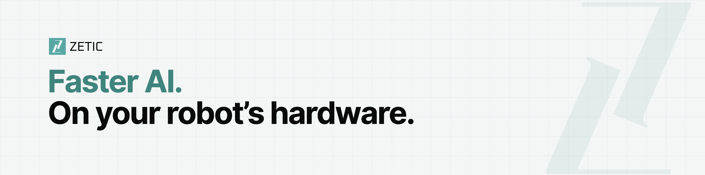

<p align="center">
  
</p>

# ixian Hexagon SDK for the Dragonwing IQ9

[](https://github.com/zetic-ai/IxianHexagon/releases)


[](https://huggingface.co/collections/ZETIC-ai/lfm3-and-d1-on-dragonwing-iq9-6af400b9da045ed7cfa23b0e)

A C++ SDK that runs the LFM3 family and the d1 decision models on the Hexagon NPU of the Qualcomm Dragonwing IQ9
(QCS9075) under Qualcomm Linux (arm64), with ZETIC's own Hexagon runtime. It contains no QNN and no llama.cpp.
Version 0.4.0.

**Use ixian Hexagon SDK 0.4.0 or later with the model files listed under [Models](#models); older SDKs cannot read
these `.ztc` files.**

- Chat models: **LFM3-1.7B** (text), **LFM3-VL-2B** (text, images, video), **LFM3-Audio-2B** (text, audio in; text,
  speech out) and **LFM3-Omni-2B** (text, images, audio, video in; text, speech out), with streaming chat.
- Decision models: **d1-2B** (text, images) and **d1-Omni-2B** (text, images, audio): yes / no, choice and score
  questions answered in one NPU pass.
- Every model is one `.ztc` file. The SDK reads it in place: nothing is unpacked or copied.
- Each model has two files: `<Model>.ztc` runs on both NSPs of the IQ9, `<Model>-1nsp.ztc` on one NSP (the other NSP
  stays free for your own work). You pick one by the file you load; there is no target option.
- Everything runs on the device. The SDK does not download anything at run time.

**[Releases](https://github.com/zetic-ai/IxianHexagon/releases) · [Models on Hugging Face](https://huggingface.co/collections/ZETIC-ai/lfm3-and-d1-on-dragonwing-iq9-6af400b9da045ed7cfa23b0e) · [zetic.ai](https://zetic.ai)**

## Download

The SDK archive is attached to this repository's Release 0.4.0: `ixian-hexagon-0.4.0-linux-arm64-qcom-iq9.tar.gz`
with its checksum file (`sha256sum -c ixian-hexagon-0.4.0-linux-arm64-qcom-iq9.tar.gz.sha256`). The model files are on
Hugging Face ([Models](#models)). This repository holds this README, the licenses ([`LICENSES/`](LICENSES)) and small
sample inputs for the examples ([`samples/`](samples)); SDK binaries are release assets only, never committed here.

## What is new in 0.4.0

- **One file per model.** A model is one `.ztc` file: `LLM::fromPath("models/LFM3-Omni-2B.ztc")`. Download the files
  listed under [Models](#models). They need SDK 0.4.0; SDK 0.4.0 loads no package folders
  (`PackageError: ... is a package directory: pass the .ztc package file`).
- **One NSP by file.** The one-NSP package is its own file (`-1nsp.ztc`). d1 now has a one-NSP file too.
- **Images and video frames of any size.** The SDK processes them as the model's Hugging Face processor does: the
  image keeps its aspect ratio and native resolution (resized to multiples of 32 pixels). `GenerationConfig::max_image_pixels`
  (d1: `Decision::Options::max_image_pixels`) sets a lower pixel ceiling when you want fewer image tokens. d1 first caps
  a picture at its package's pixel limit, as its Hugging Face processor does.
- **Faster decode on both NSPs.** One NPU call runs the decode steps back to back. LFM3-1.7B with a 1,024-token prompt
  generates 74.2 tokens/s on both NSPs and 54.3 tokens/s on one NSP; time to first token 256 ms on both NSPs.
- **The CPU stays free.** The NPU computes the whole output layer during decode.
- **Prompts closer to the original model.** The 8-bit weights of the prompt (prefill) path are made from the original
  Hugging Face weights.
- **d1 on both NSPs.** `d1-2B.ztc` / `d1-Omni-2B.ztc` split each decision pass over the two NSPs
  (`ModelInfo::nsp_count` = 2): a pass of 401 rows (an image and its questions) takes 87 ms of NPU time on both NSPs
  against 131 ms on one. The answers are the same as with one NSP.
- **Faster d1 images.** The image encoder of the d1 packages runs with 8-bit weights.
- **Removed:** `LLM::fromModelKey` (a local model-cache lookup that loaded package folders); load the `.ztc` file with
  `fromPath`.
- CMake: `find_package(IxianHexagon 0.4 CONFIG REQUIRED)`.

## What is in the SDK archive

`ixian-hexagon-0.4.0-linux-arm64-qcom-iq9.tar.gz` unpacks to one directory:

<details>
<summary>Show the archive contents</summary>

| Path | What it is |
|---|---|
| `lib/libzetic_ixian_hexagon.so` | the SDK library (C++ API in `include/`) |
| `lib/libhexrt_v73_skel.so` | the library that runs on the NPU; the SDK adds its directory to `ADSP_LIBRARY_PATH` |
| `lib/cmake/IxianHexagon/` | CMake package: `find_package(IxianHexagon)`, target `zetic::ixian_hexagon` |
| `include/` | `zetic_llm.h` (LFM3 chat), `zetic_decision.h` (d1 decisions), `zetic_media.h`, `zetic_selection.h`, `zetic_types.h` |
| `bin/zetic_quickstart`, `bin/zetic_d1_quickstart` | the two examples, built |
| `bin/zetic_lfm3_cli`, `bin/zetic_d1_cli` | test / demo / benchmark tools for the LFM3 and d1 packages |
| `examples/quickstart`, `examples/d1_quickstart` | the examples' source with their `CMakeLists.txt` (LFM3 chat; d1 decisions) |
| `LICENSES/` | the licenses of the third-party code (`NOTICE.txt` first) |
| `PROVENANCE.json`, `SHA256SUMS` | build provenance (source commit, toolchain versions) and the checksum of every file |

</details>

The binaries run on the IQ9's Ubuntu (glibc 2.35 or newer) and use the board's
`/usr/lib/aarch64-linux-gnu/libcdsprpc.so.1`. The binaries in `bin/` find the library through their own location, so they
run from any folder.

## Models

The models are not in the SDK archive. They are on Hugging Face (public), one repository per model, one `.ztc` file per
package:

| Model | Task | Hugging Face repository | File | Size | Notes |
|---|---|---|---|---:|---|
| LFM3-1.7B | chat: text | `ZETIC-ai/LFM3-1.7B-IQ9` | `LFM3-1.7B.ztc` | 2.73 GB | both NSPs |
| LFM3-1.7B | chat: text | `ZETIC-ai/LFM3-1.7B-IQ9` | `LFM3-1.7B-1nsp.ztc` | 1.99 GB | one NSP |
| LFM3-VL-2B | chat: text, image, video in | `ZETIC-ai/LFM3-VL-2B-IQ9` | `LFM3-VL-2B.ztc` | 3.10 GB | both NSPs |
| LFM3-VL-2B | chat: text, image, video in | `ZETIC-ai/LFM3-VL-2B-IQ9` | `LFM3-VL-2B-1nsp.ztc` | 2.37 GB | one NSP |
| LFM3-Audio-2B | chat: text, audio in; text, speech out | `ZETIC-ai/LFM3-Audio-2B-IQ9` | `LFM3-Audio-2B.ztc` | 3.20 GB | both NSPs |
| LFM3-Audio-2B | chat: text, audio in; text, speech out | `ZETIC-ai/LFM3-Audio-2B-IQ9` | `LFM3-Audio-2B-1nsp.ztc` | 2.46 GB | one NSP |
| LFM3-Omni-2B | chat: text, image, audio, video in; text, speech out | `ZETIC-ai/LFM3-Omni-2B-IQ9` | `LFM3-Omni-2B.ztc` | 3.58 GB | both NSPs |
| LFM3-Omni-2B | chat: text, image, audio, video in; text, speech out | `ZETIC-ai/LFM3-Omni-2B-IQ9` | `LFM3-Omni-2B-1nsp.ztc` | 2.84 GB | one NSP |
| d1-2B | decisions: text, image | `ZETIC-ai/d1-2B-IQ9` | `d1-2B.ztc` | 2.21 GB | both NSPs; 8-bit weights, answers as the original model |
| d1-2B | decisions: text, image | `ZETIC-ai/d1-2B-IQ9` | `d1-2B-1nsp.ztc` | 2.21 GB | one NSP; the same answers |
| d1-Omni-2B | decisions: text, image, audio | `ZETIC-ai/d1-Omni-2B-IQ9` | `d1-Omni-2B.ztc` | 2.44 GB | both NSPs; 8-bit weights, answers as the original model |
| d1-Omni-2B | decisions: text, image, audio | `ZETIC-ai/d1-Omni-2B-IQ9` | `d1-Omni-2B-1nsp.ztc` | 2.44 GB | one NSP; the same answers |

Each `.ztc` file is one package for the IQ9: target `v73` (both NSPs) or `v73-1nsp` (one NSP). The SDK loads only these
packages, and they need SDK 0.4.0 or later.

Download with the Hugging Face CLI (`pip install -U huggingface_hub`; on the IQ9 see [First steps](#first-steps-on-the-iq9),
step 2). The repositories are public; no token is needed:

```sh
hf download ZETIC-ai/LFM3-1.7B-IQ9 config.json LFM3-1.7B.ztc --local-dir models
hf download ZETIC-ai/LFM3-1.7B-IQ9 config.json LFM3-1.7B-1nsp.ztc --local-dir models
hf download ZETIC-ai/LFM3-VL-2B-IQ9 config.json LFM3-VL-2B.ztc --local-dir models
hf download ZETIC-ai/LFM3-VL-2B-IQ9 config.json LFM3-VL-2B-1nsp.ztc --local-dir models
hf download ZETIC-ai/LFM3-Audio-2B-IQ9 config.json LFM3-Audio-2B.ztc --local-dir models
hf download ZETIC-ai/LFM3-Audio-2B-IQ9 config.json LFM3-Audio-2B-1nsp.ztc --local-dir models
hf download ZETIC-ai/LFM3-Omni-2B-IQ9 config.json LFM3-Omni-2B.ztc --local-dir models
hf download ZETIC-ai/LFM3-Omni-2B-IQ9 config.json LFM3-Omni-2B-1nsp.ztc --local-dir models
hf download ZETIC-ai/d1-2B-IQ9 config.json d1-2B.ztc --local-dir models
hf download ZETIC-ai/d1-2B-IQ9 config.json d1-2B-1nsp.ztc --local-dir models
hf download ZETIC-ai/d1-Omni-2B-IQ9 config.json d1-Omni-2B.ztc --local-dir models
hf download ZETIC-ai/d1-Omni-2B-IQ9 config.json d1-Omni-2B-1nsp.ztc --local-dir models
```

Each command puts the `.ztc` file and the repository's `config.json` (its file list with each file's size and sha256)
into `models/`. The SDK reads only the `.ztc` file. If a download stops (connection lost, Ctrl-C, disk full), run the
same command again: it resumes. The partly downloaded file waits in `models/.cache/huggingface/download/` as
`*.incomplete`; to give up on a model and get the space back, delete it there. `du -sh models/*` shows what is already
there. The model weights are under the LFM Open License v1.0 (Liquid AI): see the `LICENSE` file of each repository.

## Requirements and limits

**Device.** The Dragonwing IQ9 (QCS9075) with its Ubuntu (Qualcomm Linux, arm64). On any other device,
`LLM::fromPath` / `Decision::fromPath` fail with `Status::Unsupported`; packages for any other device or model are
refused the same way. Tested from `ssh` with the CLIs and the library.

**SDK version.** The `.ztc` files listed above need SDK 0.4.0 or later.

**LFM3 chat (`zetic_llm.h`).**
- Context: 2,048 positions for the prompt and the reply together by default. A larger context is set at load with
  `LLMOptions::max_context` (CLI `--ctx`):

  | LFM3 packages | Default (`max_context = 0`) | Largest `max_context` |
  |---|---:|---:|
  | `<Model>.ztc` (both NSPs) | 2,048 | 131,072 |
  | `<Model>-1nsp.ztc` (one NSP) | 2,048 | 4,096 |

  A value above 2,048 switches the runtime to its long-context mode at load (the KV heads split over the two NSPs; no
  other package). It costs memory (~48 MB more at 4,096, ~0.4 GB at 32,768, ~1.6 GB at 131,072); set it only as large
  as the app needs. The reply is reserved up front: prompt rows + `max_tokens` (+ speech frames) must fit, or the
  request returns `Status::ContextExceeded`.
- Chat is stateless: send the whole message history with every `chat()` call. The prefix cache keeps the rows of the
  previous request (media rows too), so a text follow-up does not re-encode the media.
  `GenerationConfig::cache_prompt = false` turns the caches off.
- Default sampling comes from the `generation` block of each package's manifest, which the SDK reads at load. A
  `GenerationConfig` field you set (0 or more) overrides it.

  | Package | Default text sampling |
  |---|---|
  | LFM3-1.7B, LFM3-VL-2B | temperature 0.1, top-k 50, repetition penalty 1.1, sampled on the CPU |
  | LFM3-Audio-2B, LFM3-Omni-2B | temperature 0 (greedy), repetition penalty 1.0 |

  Speech output samples its audio codes separately: Audio-2B temperature 1.0 / top-k 128 / repetition penalty 1.1,
  Omni-2B 0.4 / all codes / 1.2 (`AudioOutputConfig`).
- Greedy: `GenerationConfig::temperature = 0`. Greedy takes the NPU's argmax and never reads the logits; the repetition
  penalty is 1.0 unless you set one.
- Thinking: `GenerationConfig::enable_thinking` per request (default off). On returns the thinking in
  `Response::reasoning_content` (stream: `StreamEvent::reasoning`) and the answer in `Response::text`. Append
  `Message::Assistant(response.text)` instead of `response.message` to drop the thinking from the next turn.

**Images, audio and video (LFM3-VL-2B, LFM3-Audio-2B, LFM3-Omni-2B; images and audio also for d1).**
- Images of any size. The SDK processes an image as the model's Hugging Face processor does: it keeps the aspect ratio
  and the native resolution, resized to multiples of 32 pixels (about one image token per 32 x 32 pixels), with no
  fixed box and no tiling. `GenerationConfig::max_image_pixels` lowers the pixel ceiling; the SDK never shrinks an image
  silently. The prompt with its image tokens must fit the context (`Status::ContextExceeded` otherwise): a 1920 x 1080
  photo is about 2,000 image tokens. `Image::fromFile` decodes PNG / JPEG / BMP / GIF / PPM; `Image::fromRgb` /
  `fromRgba` take 8-bit pixels from memory.
- Audio: `Audio::fromWav` (PCM 8 / 16 / 24 / 32-bit or float WAV) or `Audio::fromPcm` (float samples, any rate); mixed to
  mono and resampled to 16 kHz. One audio part holds up to 30 s; split longer audio into several parts.
- Video: `Part::Vid(Video::fromFrames(frames, fps))` with decoded frames of any size, all the same size (the app decodes
  the container, for example MP4). The SDK samples 2 fps and sizes the frames as the Hugging Face video processor does
  (one pixel budget for the whole clip, so longer clips get smaller frames).
- Several media per message work on every media model, in prompt order (Omni: images and clips mixed).

**Speech output (LFM3-Audio-2B, LFM3-Omni-2B).** 24 kHz mono. The first chunk comes after one codec frame (80 ms of
speech); `AudioOutputConfig` sets the chunk sizes. Length: `max_audio_seconds` (default 30); `logprobs` is not available
with audio output.

**d1 decisions (`zetic_decision.h`).**
- Three question types, all asked as text: yes / no (`Question::Noul`), one or several of a list (`Question::Choice`)
  and a score on a scale (`Question::Score`). d1 does not write text, speech or chat replies.
- One NPU pass answers up to 16 questions on one state; more questions take more passes. The state, its media and the
  pass's questions must fit one pass of up to **2,048 rows** (an image is 256 rows after d1's pixel cap, a 30 s clip
  375). There is no setting for it (`Decision::Options` has no context option): read `Capabilities::max_context`
  (`zetic_d1_cli info` prints it as `max rows`) instead of hard-coding the number.
- Images (d1-2B, d1-Omni-2B) and audio clips (d1-Omni-2B) are encoded once per request. d1 caps a picture at its
  package's pixel limit and then processes it as its Hugging Face processor does. d1 takes no video
  (`Status::Unsupported`).
- `d1-2B.ztc` / `d1-Omni-2B.ztc` run each pass on **both NSPs** (`ModelInfo::nsp_count` = 2); `d1-2B-1nsp.ztc` /
  `d1-Omni-2B-1nsp.ztc` on one. Both give the same answers. NPU time per pass on the IQ9, by pass length (d1-Omni-2B
  the same per row count):

  | Rows per pass | 43 | 144 | 294 | 401 | 1,024 | 2,048 |
  |---|---:|---:|---:|---:|---:|---:|
  | both NSPs (ms) | 32.4 | 47.3 | 76.0 | 87.4 | 183.2 | 387.4 |
  | one NSP (ms) | 38.9 | 55.9 | 99.1 | 131.0 | 331.9 | 751.0 |

  A text-only request with a few questions is about 40 to 150 rows; a 512 x 512 image adds 256.
- Accuracy: 8-bit weights and 16-bit activations. Measured on the IQ9 with the SDK (`zetic_d1_cli ask`, both NSPs; the
  test set: 181 questions for d1-2B over text and image requests, 231 for d1-Omni-2B with audio):

  | | d1-2B | d1-Omni-2B |
  |---|---:|---:|
  | Correct answers (the original model: 137 / 181, 177 / 231) | 137 / 181 | 177 / 231 |
  | Top answer equal to the original model's | 181 / 181 | 231 / 231 |
  | Probability difference to the original model, mean / max | 0.004 / 0.032 | 0.004 / 0.039 |
  | Time per request: text, a passage and 1 question (ms) | 79 | 69 |
  | Time per request: one 512 x 512 image and 1 question (ms) | 129 | 128 |
  | Time per request: one audio clip and 1 question (ms) | - | 52 |

  Times are the median of the test set's 25 requests of that kind, from the request to the answers, image or audio
  encoding included; the text requests are short, so their time is mostly not the NPU pass. The one-NSP files give the
  same answers as the two-NSP files.

**One active model per process.** To free the NPU, destroy the `LLM` / `Decision` object; loading again takes a few
seconds.

## First steps on the IQ9

Everything below runs on the IQ9 itself (log in with `ssh`), in one working folder. The board's Ubuntu has `git`,
`python3` and `g++`, but no `pip`, `hf` or `gh`; step 2 installs the model downloader in a local Python environment.

**1. Check the free space, then get the SDK and the sample inputs.**

```bash
mkdir ixh && cd ixh
df -h .                                 # "Avail" should be 7 GB or more for the two Omni models below
curl -LO https://github.com/zetic-ai/IxianHexagon/releases/download/0.4.0/ixian-hexagon-0.4.0-linux-arm64-qcom-iq9.tar.gz
curl -LO https://github.com/zetic-ai/IxianHexagon/releases/download/0.4.0/ixian-hexagon-0.4.0-linux-arm64-qcom-iq9.tar.gz.sha256
sha256sum -c ixian-hexagon-0.4.0-linux-arm64-qcom-iq9.tar.gz.sha256      # must print OK
tar xzf ixian-hexagon-0.4.0-linux-arm64-qcom-iq9.tar.gz
git clone --depth 1 https://github.com/zetic-ai/IxianHexagon             # samples/: images, audio, video frames, d1 requests
SDK=$PWD/ixian-hexagon-0.4.0-linux-arm64-qcom-iq9
S=$PWD/IxianHexagon/samples
```

`SDK` and `S` are only shortcuts for the commands below; set them again in a new shell. The model files are large
(sizes under [Models](#models)). The SDK, the samples and the Python environment add about 0.2 GB. With less free
space, free some first or download one model at a time.

**2. Install the Hugging Face downloader (once).**

```bash
python3 -m venv .venv                   # "ensurepip is not available": sudo apt install -y python3-venv, then again
.venv/bin/pip install -U huggingface_hub
```

**3. Download the models.** One `.ztc` file per command (all files: [Models](#models)):

```bash
.venv/bin/hf download ZETIC-ai/LFM3-Omni-2B-IQ9 config.json LFM3-Omni-2B.ztc --local-dir models   # both NSPs, 3.58 GB
.venv/bin/hf download ZETIC-ai/d1-Omni-2B-IQ9 config.json d1-Omni-2B.ztc --local-dir models       # both NSPs, 2.44 GB
```

For one NSP, download `LFM3-Omni-2B-1nsp.ztc` / `d1-Omni-2B-1nsp.ztc` the same way and pass that file below.

**4. Check the downloads.** `info --verify` checks every file inside the package against its checksums and loads the
model once.

```bash
$SDK/bin/zetic_lfm3_cli info --model models/LFM3-Omni-2B.ztc --verify
$SDK/bin/zetic_d1_cli info --model models/d1-Omni-2B.ztc --verify
```

**5. Run the examples on the samples.** The built examples are in `bin/`; their source is in `examples/`.

```bash
# LFM3-Omni-2B: text, image, audio (a spoken question), image + audio
$SDK/bin/zetic_quickstart models/LFM3-Omni-2B.ztc "What is the capital of France?"
$SDK/bin/zetic_quickstart models/LFM3-Omni-2B.ztc "What is in this picture?" $S/cats.png
$SDK/bin/zetic_quickstart models/LFM3-Omni-2B.ztc "Answer the question in the audio." $S/question.wav
$SDK/bin/zetic_quickstart models/LFM3-Omni-2B.ztc "Answer the question in the audio." $S/cats.png $S/question_cats.wav
# d1-Omni-2B: text, image, audio, image + audio
$SDK/bin/zetic_d1_quickstart models/d1-Omni-2B.ztc
$SDK/bin/zetic_d1_quickstart models/d1-Omni-2B.ztc "The photo shows what arrived instead of my order." $S/cats.png
$SDK/bin/zetic_d1_quickstart models/d1-Omni-2B.ztc "A customer sent this recording." $S/jfk.wav
$SDK/bin/zetic_d1_quickstart models/d1-Omni-2B.ztc "A customer sent a photo and a recording." $S/cats.png $S/jfk.wav
```

- `zetic_quickstart` answers, then asks one follow-up ("And its population?") that reuses the cached first turn (the
  media are not encoded again).
- `zetic_d1_quickstart` asks three ticket questions about the text in one NPU pass: `refund` (yes / no, prints P(yes)),
  `team` (billing or shipping) and `urgency` (low / medium / high). With an image it adds `animal` ("Does the image show an
  animal?"); with audio it adds `speech` ("Is a person speaking in the audio?") and `topic` (country / sports / cooking).
  Measured on the IQ9 with the commands above:

  | Input | Answers | Tokens, time |
  |---|---|---|
  | default ticket | refund P(yes) 0.943, team billing (0.513), urgency medium (0.605) | 117, 121 ms |
  | `cats.png` | animal P(yes) 0.926 | 393, 193 ms |
  | `jfk.wav` | speech P(yes) 0.716, topic country (0.978) | 308, 180 ms |
  | `cats.png` + `jfk.wav` | animal P(yes) 0.927, speech P(yes) **0.475**, topic country (0.973) | 592, 310 ms |

  The answers are probabilities, not verdicts. The same recording gets speech P(yes) 0.72 alone but 0.48 next to a photo,
  and team billing wins over shipping by 0.513 to 0.487: do not read every P(yes) against a fixed 0.5. Calibrate the
  threshold per question on your own examples, and ask about one medium per question where you can.
  `zetic_d1_cli ask --model models/d1-Omni-2B.ztc --requests $S/requests_audio.jsonl --verbose` asks the two audio
  questions about `jfk.wav` with no text at all (on the IQ9: speech P(yes) 0.86, topic country 0.98).

To build the same examples from source (CMake once: `sudo apt install -y cmake`):

```bash
cmake -S $SDK/examples/quickstart -B build-quickstart -DCMAKE_PREFIX_PATH=$SDK/lib/cmake
cmake --build build-quickstart
build-quickstart/quickstart models/LFM3-Omni-2B.ztc "What is in this picture?" $S/cats.png
cmake -S $SDK/examples/d1_quickstart -B build-d1 -DCMAKE_PREFIX_PATH=$SDK/lib/cmake
cmake --build build-d1
build-d1/d1_quickstart models/d1-Omni-2B.ztc
```

When the SDK folder changes (a new version, another path), configure into a **new** build folder (or delete the old one):
CMake keeps the old SDK path in its cache, so configure fails or the old binary keeps running.

### Your own images, audio and video

Images can be any size (PNG, JPEG, BMP, GIF, PPM files, or RGB pixels from memory): pass the file as it is. Audio is a
WAV clip of up to 30 s per part, and video a folder of frames. `ffmpeg` prepares audio and video
(`sudo apt install -y ffmpeg` once):

```bash
# any audio (m4a, mp3, wav, ...) -> 16 kHz mono 16-bit WAV
ffmpeg -i voice.m4a -ac 1 -ar 16000 -c:a pcm_s16le voice_16k.wav
# audio longer than 30 s -> 29 s pieces part_000.wav, part_001.wav, ... (pass them as several audio parts)
ffmpeg -i long.m4a -f segment -segment_time 29 -ac 1 -ar 16000 -c:a pcm_s16le part_%03d.wav
# a video -> frames at 2 per second, then ask about the folder
mkdir frames && ffmpeg -i clip.mp4 -vf "fps=2" frames/frame_%03d.png
$SDK/bin/zetic_lfm3_cli chat --model models/LFM3-Omni-2B.ztc --media frames --video-fps 2 "Describe what happens in this video."
```

A large photo becomes many image tokens (a 1920 x 1080 photo is about 2,000), which take prompt time and context. Load
with a larger `max_context` (CLI `--ctx 4096`) for very large pictures, or set `max_image_pixels` to cap them.
[`samples/SOURCES.md`](samples/SOURCES.md) lists every sample with its source and license.

### Command-line tools

- `--model` takes the package file (`models/LFM3-Omni-2B.ztc`); the one-NSP package is `models/LFM3-Omni-2B-1nsp.ztc`.
- `zetic_lfm3_cli` commands: `chat`, `eval`, `bench`, `info`; it prints its usage when run without arguments. In the
  usage text `a | b` means "a or b", not a shell pipe. `zetic_d1_cli` commands: `info`, `demo`, `ask`, `serve`, each
  with `--model <file>.ztc`.
- Chat, speech output and voice chat:

  ```bash
  $SDK/bin/zetic_lfm3_cli chat --model models/LFM3-Omni-2B.ztc "What is the capital of France?"
  $SDK/bin/zetic_lfm3_cli chat --model models/LFM3-Omni-2B.ztc -i                     # multi-turn; /exit or Ctrl-D ends it
  $SDK/bin/zetic_lfm3_cli chat --model models/LFM3-Omni-2B.ztc --media $S/cats.png+$S/jfk.wav "Describe the image, then repeat what the speaker says."
  $SDK/bin/zetic_lfm3_cli chat --model models/LFM3-Omni-2B.ztc --tts --out reply_tts.wav "The quick brown fox jumps over the lazy dog."
  $SDK/bin/zetic_lfm3_cli chat --model models/LFM3-Omni-2B.ztc --voice --media $S/question.wav --out reply_voice.wav "Answer the question in the audio."
  ```

  `--tts` speaks the given text; `--voice` answers in text and speech together. Both write a 24 kHz mono WAV (`--out`).
- With `--data $S` the eval / bench presets read the samples:

  ```bash
  $SDK/bin/zetic_lfm3_cli bench vl --model models/LFM3-Omni-2B.ztc --data $S          # cats.ppm, "Describe the image in detail."
  $SDK/bin/zetic_lfm3_cli bench ia --model models/LFM3-Omni-2B.ztc --data $S          # cats + jfk.wav
  $SDK/bin/zetic_lfm3_cli bench media --model models/LFM3-Omni-2B.ztc --data $S --media jfk.wav --system "Perform ASR in English."
  $SDK/bin/zetic_lfm3_cli bench tts --model models/LFM3-Omni-2B.ztc --data $S
  $SDK/bin/zetic_lfm3_cli bench voice --model models/LFM3-Omni-2B.ztc --data $S --media question.wav
  $SDK/bin/zetic_lfm3_cli eval vl5 --model models/LFM3-Omni-2B.ztc --data $S --png --only cats,color,count,ocr
  $SDK/bin/zetic_lfm3_cli eval video --model models/LFM3-Omni-2B.ztc --data $S       # clip1/: 72 frames at 24 fps
  $SDK/bin/zetic_lfm3_cli bench text --model models/LFM3-Omni-2B.ztc --ids $S/jfk_inaugural_ids.txt
  $SDK/bin/zetic_lfm3_cli eval ppl --model models/LFM3-Omni-2B.ztc --ids $S/jfk_inaugural_ids.txt
  ```

  - The samples hold no 30 s lecture or other clips, so `bench asr` / `bench asr30` and `eval asr` / `omni5` / `mt` need
    your own files (`--media`, `--only`).
  - `eval video` stops each answer at 96 tokens (`finish length`); add `--max-tokens 256` for a full description.
  - `bench text` and `eval ppl` read only the start of the ids file: a prompt of about 1,024 rows (`--n`); `eval ppl` then
    scores the next 257 tokens (`--score`).
  - `bench text` writes its prompt ids to `./zsdk_bench_ids.txt`. `bench tts` / `bench voice` write one WAV per repetition
    (4 by default, `--reps`) under `./zsdk_speech_ab/` (`--work` changes it).
- d1 from files or from another program:

  ```bash
  $SDK/bin/zetic_d1_cli demo --model models/d1-Omni-2B.ztc
  $SDK/bin/zetic_d1_cli ask --model models/d1-Omni-2B.ztc --requests $S/requests.jsonl --out answers.tsv --verbose
  $SDK/bin/zetic_d1_cli serve --model models/d1-Omni-2B.ztc < $S/requests.jsonl
  ```

  - `demo` asks a support ticket's questions (yes / no, choice, score) in one pass.
  - A request is one JSON object per line (see `$S/requests.jsonl`): `state`, `questions`, optional `images` / `files`
    (base64 data URLs), `name` and `id`.
  - `ask --out` writes one tab-separated line per request (not JSON Lines): `<name> TAB <seconds> TAB {"answers": ...}`.
  - `serve` is not an HTTP server: it reads JSON Lines on stdin and writes JSON Lines on stdout, one process per model
    (the model stays loaded until stdin ends). The first line is `{"event": "ready", ...}`; then each request gets one
    answer line, in the order the requests arrive, carrying the request's `id` (`null` when the request has none). Match
    answers by `id`, or by order. Logs go to stderr.
- `rtf` (speech benches, `Timings::realtime_factor`) = seconds of audio produced / seconds spent producing it. Above 1 is
  faster than real time: `rtf 3.2x` made 2.4 s of speech in 0.75 s.

## Use the SDK in your code

LFM3 chat:

```cpp
#include <zetic_llm.h>
using namespace zetic::ixian;

LLM llm = LLM::fromPath("/home/user/ixh/models/LFM3-1.7B.ztc");   // both NSPs; LFM3-1.7B-1nsp.ztc for one
std::vector<Message> history{Message::User("What is the capital of France?")};
Response r = llm.chat(history, {}, [](const StreamEvent& ev) {
  if (ev.type == StreamEvent::Type::Text) fwrite(ev.text.data(), 1, ev.text.size(), stdout);
  return true;                                                      // false stops the reply
});
if (r.status != Status::Ok) { /* r.error says why */ }
history.push_back(r.message);                                       // follow-ups reuse the cached prefix
history.push_back(Message::User("And its population?"));
Response r2 = llm.chat(history);
```

Images and audio in (LFM3-VL-2B, LFM3-Audio-2B, LFM3-Omni-2B):

```cpp
LLM vl = LLM::fromPath("models/LFM3-VL-2B.ztc");                   // or LFM3-Omni-2B.ztc
GenerationConfig greedy; greedy.temperature = 0;
Response r = vl.chat({Message::User({Part::Img(Image::fromFile("samples/cats.png")),   // any size
                                     Part::Text("How many cats are in the image?")})}, greedy);

LLM asr = LLM::fromPath("models/LFM3-Audio-2B.ztc");
Response t = asr.chat({Message::System("Perform ASR in English."),
                       Message::User({Part::Aud(Audio::fromWav("samples/jfk.wav"))})}, greedy);
```

Speech out (LFM3-Audio-2B, LFM3-Omni-2B):

```cpp
LLM m = LLM::fromPath("models/LFM3-Audio-2B.ztc");                  // or LFM3-Omni-2B.ztc
GenerationConfig tts;
tts.modalities = {Modality::Audio};                                 // TTS; {Text, Audio} = voice chat
Response r = m.chat({Message::System("Perform TTS in American English using a female voice."),
                     Message::User("The quick brown fox jumps over the lazy dog.")}, tts,
                    [](const StreamEvent& ev) {
                      if (ev.type == StreamEvent::Type::Audio) play(ev.audio->pcm, ev.audio->samples);  // 24 kHz mono float
                      return true;
                    });
// r.audio: the whole clip; r.timings.first_audio, r.timings.realtime_factor (audio seconds / generation seconds)
```

For voice chat, put the user's speech in as `Part::Aud(...)` and ask for `{Modality::Text, Modality::Audio}`; text and
speech stream together.

A larger context (LFM3 only; the limits are under [Requirements and limits](#requirements-and-limits)):

```cpp
LLM::Options opt;
opt.max_context = 8192;                                             // positions; 0 = 2,048
LLM llm = LLM::fromPath("models/LFM3-Omni-2B.ztc", opt);           // CLI: zetic_lfm3_cli chat --ctx 8192 ...
```

d1 decisions:

```cpp
#include <zetic_decision.h>
using namespace zetic::ixian;

Decision d1 = Decision::fromPath("/home/user/ixh/models/d1-2B.ztc");   // both NSPs; d1-2B-1nsp.ztc for one
DecisionResult out = d1.systemOne(State::Text("I was charged twice and my parcel never arrived. Please refund one charge."), {
    {"refund",  Question::Noul("Is the customer asking for a refund?")},
    {"team",    Question::Choice("Which team should handle this?", {{"billing", "Charges, refunds, invoices"},
                                                                    {"shipping", "Delivery and parcels"}})},
    {"urgency", Question::Score("How urgent is this ticket?", {"low", "medium", "high"})}});
// out.answers[0].second.noul = P(yes); answers[1].second.choice = "billing"; answers[2].second.legend = "medium"
// images / audio: Part::Img(Image::fromFile(...)), Part::Aud(Audio::fromWav(...)) in the third argument
```

Loading throws `zetic::ixian::Error` (missing files, wrong device, a d1 package opened as `LLM`); a request reports
problems in `Response::status` / `Response::error` (for d1: `DecisionResult::status` / `error`). Check both. The
headers in `include/` describe every field. Full examples: `examples/quickstart` and `examples/d1_quickstart` in the SDK archive.

Build with the SDK's CMake package, in your own `CMakeLists.txt`:

```cmake
find_package(IxianHexagon 0.4 CONFIG REQUIRED)   # cmake -DCMAKE_PREFIX_PATH=<sdk>/lib/cmake
target_link_libraries(my_app PRIVATE zetic::ixian_hexagon)
```

Keep `lib/libhexrt_v73_skel.so` next to `libzetic_ixian_hexagon.so`, or pass its directory as `LLMOptions::native_lib_dir`
(`Decision::Options::native_lib_dir` for d1).

## Common errors

| Message | What it means | What to do |
|---|---|---|
| `PackageError: ... is a package directory: pass the .ztc package file` | A package folder was passed. | Download the model's `.ztc` file ([Models](#models)) and pass its path. |
| `DeviceError: hexrt_lib_open: map: 0x1` at load | The DSP could not map the model, most often right after another NPU process has exited. | Wait a few seconds and run the command again. |
| `[hexrt] weights.bin (... MB) did not map as one buffer (0x1): N pieces of <= 512 MB` | A warning: the weights are mapped in pieces instead. | Nothing; the run continues normally. |
| `ContextExceeded: the request needs N prompt rows + M reply rows, the context holds 2048` (LFM3) | The prompt plus the reserved reply does not fit the context (large images take many rows). | Load with a larger `max_context` (CLI `--ctx 4096`), set `max_image_pixels`, lower `max_tokens` / `max_audio_seconds`, or shorten the history. |
| `ContextExceeded: rows: question 0 with its state and media is N rows, a d1 pass holds 2048` (d1) | One question with its state and media is longer than a d1 pass. | Shorten the state text or use fewer / shorter media; d1 has no larger setting. |
| `Unsupported: d1 takes no video input (images and audio only)` | d1 models take text, images and (d1-Omni-2B) audio only. | Pass a few frames as images, or use LFM3-VL-2B / LFM3-Omni-2B for video. |
| `... is a d1 decision package: load it with Decision::fromPath` | A d1 model was opened with `LLM` (for example with `zetic_quickstart`). | Use `zetic_d1_quickstart` / `zetic_d1_cli`, or `Decision::fromPath` in code. |
| `cannot read <file>` from `eval` / `bench` | The preset's input file is not in the `--data` folder. | Use `--data <samples folder>`, or give your own file with `--media` / `--only`. |
| `hf: command not found`, `pip: command not found` | The board has no system `pip` / `hf`. | Use the virtual environment of step 2: `.venv/bin/pip`, `.venv/bin/hf`. |
| `No space left on device`, or `hf download` stops making progress | The disk is full (`df -h .`). | Free space, delete partial downloads (`models/.cache/huggingface/download/*.incomplete`), then rerun the same `hf download`. |
| CMake configure fails, or a rebuilt example still behaves like the old one | The build folder's cache points at another SDK folder. | Configure into a new build folder (`-B build-new`) or delete the old one. |
| `error while loading shared libraries: libzetic_ixian_hexagon.so` | An app built elsewhere does not find the library. | Build with the CMake package as above, or set `LD_LIBRARY_PATH=<sdk>/lib`. |

## Licenses

- The LFM3 and d1 model weights are not part of the SDK. They are under the LFM Open License v1.0 (Liquid AI): see the
  `LICENSE` file of each Hugging Face repository.
- Third-party code in the SDK: [`LICENSES/`](LICENSES) here and in the SDK archive (start with [`LICENSES/NOTICE.txt`](LICENSES/NOTICE.txt)): tokenizers-cpp (Apache-2.0) with the Hugging Face
  `tokenizers` Rust crate and its crates.io dependencies (MIT / Apache-2.0; the list and every linked crate's license
  files are in `tokenizers-rust-notices.txt`), Oniguruma (BSD-2-Clause), esaxx and sais-lite (MIT), nlohmann/json (MIT),
  stb_image v2.30 (public domain / MIT).
- The DSP library `lib/libhexrt_v73_skel.so` and the FastRPC stub inside the SDK library are built with the Qualcomm
  Hexagon SDK (`PROVENANCE.json`).
- The sample inputs in [`samples/`](samples) carry their own licenses, listed per file in
  [`samples/SOURCES.md`](samples/SOURCES.md) (the cat photo is CC BY-SA 2.0; the rest is public domain or CC0 1.0).

---

<p align="center">Packaged by <a href="https://zetic.ai">ZETIC</a> · <a href="https://ixian.zetic.ai">ixian-bench</a> · ✉️ contact@zetic.ai</p>
