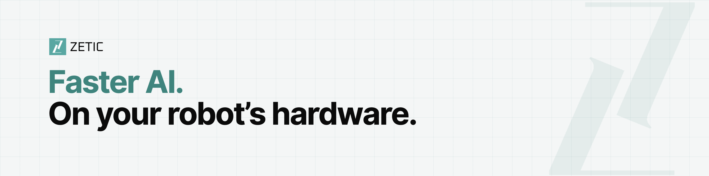

<p align="center">
  
</p>

# Ixian Hexagon SDK for the Dragonwing IQ9

[](https://github.com/zetic-ai/IxianHexagon/releases)


[](https://huggingface.co/collections/ZETIC-ai/lfm3-and-d1-on-dragonwing-iq9-6af400b9da045ed7cfa23b0e)

This repository distributes the Ixian Hexagon SDK for the Qualcomm Dragonwing IQ9 (QCS9075) as binaries.
The SDK runs the LFM3 family and the d1 decision models on the Hexagon NPU of the IQ9 with ZETIC's own Hexagon
runtime. Each SDK version is a GitHub Release; the model packages are on Hugging Face; [`samples/`](samples) holds small
inputs for the examples.

**[Releases](https://github.com/zetic-ai/IxianHexagon/releases) · [Models on Hugging Face](https://huggingface.co/collections/ZETIC-ai/lfm3-and-d1-on-dragonwing-iq9-6af400b9da045ed7cfa23b0e) · [zetic.ai](https://zetic.ai)**

| Device | SoC | Package target | OS |
|---|---|---|---|
| Dragonwing IQ9, both NSPs (default) | QCS9075 | `v73` | Ubuntu 24.04 |
| Dragonwing IQ9, one NSP | QCS9075 | `v73-1nsp` (`LLMOptions::target`, CLI `--target`) | the same |

> [!NOTE]
> The SDK runs on the IQ9 only. On any other device, `LLM::fromPath` / `Decision::fromPath` fail with
> `Status::Unsupported`. Packages for any other target or model are refused the same way.

## Quick start: first 5 steps on the IQ9

Everything below runs on the IQ9 itself (log in with `ssh`), in one working folder. The board's Ubuntu has `git`,
`python3` and `g++`, but no `pip`, `hf` or `gh`; step 2 installs the model downloader in a local Python environment.

**1. Get the SDK and the sample inputs.**

```bash
mkdir ixh && cd ixh
curl -LO https://github.com/zetic-ai/IxianHexagon/releases/download/0.2.2/ixian-hexagon-0.2.2-linux-arm64-qcom-iq9.tar.gz
curl -LO https://github.com/zetic-ai/IxianHexagon/releases/download/0.2.2/ixian-hexagon-0.2.2-linux-arm64-qcom-iq9.tar.gz.sha256
sha256sum -c ixian-hexagon-0.2.2-linux-arm64-qcom-iq9.tar.gz.sha256      # must print OK
tar xzf ixian-hexagon-0.2.2-linux-arm64-qcom-iq9.tar.gz
git clone --depth 1 https://github.com/zetic-ai/IxianHexagon             # samples/: images, audio, video frames, d1 requests
SDK=$PWD/ixian-hexagon-0.2.2-linux-arm64-qcom-iq9
S=$PWD/IxianHexagon/samples
```

`SDK` and `S` are only shortcuts for the commands below; set them again in a new shell.

**2. Install the Hugging Face downloader (once).**

```bash
python3 -m venv .venv                   # "ensurepip is not available": sudo apt install -y python3-venv, then again
.venv/bin/pip install -U huggingface_hub
```

**3. Download the models.** One Hugging Face repository per model; `--include "v73/*"` takes only the two-NSP package.

```bash
.venv/bin/hf download ZETIC-ai/LFM3-Omni-2B-IQ9 --include "v73/*" --local-dir models/lfm3-omni-2b    # 3.6 GB
.venv/bin/hf download ZETIC-ai/d1-Omni-2B-IQ9 --include "v73/*" --local-dir models/d1-omni-2b        # 2.4 GB
```

If a download stops or the connection drops, run the same command again; it continues. All six models:

| Model | Hugging Face | Input | Output | API | Targets |
|---|---|---|---|---|---|
| LFM3-1.7B | [ZETIC-ai/LFM3-1.7B-IQ9](https://huggingface.co/ZETIC-ai/LFM3-1.7B-IQ9) | text | text | `LLM` | `v73`, `v73-1nsp` |
| LFM3-VL-2B | [ZETIC-ai/LFM3-VL-2B-IQ9](https://huggingface.co/ZETIC-ai/LFM3-VL-2B-IQ9) | text, image, video | text | `LLM` | `v73`, `v73-1nsp` |
| LFM3-Audio-2B | [ZETIC-ai/LFM3-Audio-2B-IQ9](https://huggingface.co/ZETIC-ai/LFM3-Audio-2B-IQ9) | text, audio | text, speech | `LLM` | `v73`, `v73-1nsp` |
| LFM3-Omni-2B | [ZETIC-ai/LFM3-Omni-2B-IQ9](https://huggingface.co/ZETIC-ai/LFM3-Omni-2B-IQ9) | text, image, audio, video | text, speech | `LLM` | `v73`, `v73-1nsp` |
| d1-2B | [ZETIC-ai/d1-2B-IQ9](https://huggingface.co/ZETIC-ai/d1-2B-IQ9) | text, image | decisions | `Decision` | `v73` (runs on one NSP) |
| d1-Omni-2B | [ZETIC-ai/d1-Omni-2B-IQ9](https://huggingface.co/ZETIC-ai/d1-Omni-2B-IQ9) | text, image, audio | decisions | `Decision` | `v73` (runs on one NSP) |

The model weights are under the LFM Open License v1.0 (Liquid AI); see the `LICENSE` file of each Hugging Face repository.
Sign in with `.venv/bin/hf auth login` if your account needs access.

**4. Check the downloads.** `info --verify` checks every package file against its `SHA256SUMS` and loads the model once.

```bash
$SDK/bin/zetic_lfm3_cli info --model models/lfm3-omni-2b --verify
$SDK/bin/zetic_d1_cli info --model models/d1-omni-2b --verify
```

**5. Run the examples on the samples.** The prebuilt examples are in `bin/`; their source is in `examples/`.

```bash
$SDK/bin/zetic_quickstart models/lfm3-omni-2b "What is the capital of France?"
$SDK/bin/zetic_quickstart models/lfm3-omni-2b "What is in this picture?" $S/cats.png
$SDK/bin/zetic_quickstart models/lfm3-omni-2b "Answer the question in the audio." $S/question.wav
$SDK/bin/zetic_quickstart models/lfm3-omni-2b "Answer the question in the audio." $S/cats.png $S/question_cats.wav
$SDK/bin/zetic_d1_quickstart models/d1-omni-2b
$SDK/bin/zetic_d1_quickstart models/d1-omni-2b "The photo shows what arrived instead of my order." $S/cats.png
```

Each `zetic_quickstart` run answers, then asks one follow-up question that reuses the cached first turn (the media are not
encoded again). `zetic_d1_quickstart` asks a yes / no, a choice and a score question in one NPU pass and prints the
answers with their probabilities. Build the same examples from source (CMake once: `sudo apt install -y cmake`):

```bash
cmake -S $SDK/examples/quickstart -B build-quickstart -DCMAKE_PREFIX_PATH=$SDK/lib/cmake
cmake --build build-quickstart
build-quickstart/quickstart models/lfm3-omni-2b "What is in this picture?" $S/cats.png
cmake -S $SDK/examples/d1_quickstart -B build-d1 -DCMAKE_PREFIX_PATH=$SDK/lib/cmake
cmake --build build-d1
build-d1/d1_quickstart models/d1-omni-2b
```

> [!IMPORTANT]
> **Images and video frames must be exactly 512 x 512 RGB** (LLM and d1 alike); the SDK does not resize. Audio is WAV at
> any rate, up to 30 s per clip. The files in [`samples/`](samples) already fit; [`samples/SOURCES.md`](samples/SOURCES.md)
> lists their sources and licenses.

<details>
<summary>What's in the SDK</summary>

| Path in the SDK | Content |
|---|---|
| `lib/libzetic_ixian_hexagon.so` | the SDK library (public API only) |
| `lib/libhexrt_v73_skel.so` | the DSP library; the SDK adds its directory to `ADSP_LIBRARY_PATH` |
| `include/` | `zetic_llm.h`, `zetic_media.h`, `zetic_decision.h`, `zetic_selection.h`, `zetic_types.h` |
| `lib/cmake/IxianHexagon/` | CMake package config |
| `bin/zetic_quickstart`, `bin/zetic_d1_quickstart` | the two examples, prebuilt |
| `bin/zetic_lfm3_cli`, `bin/zetic_d1_cli` | test / demo / benchmark CLIs |
| `examples/quickstart`, `examples/d1_quickstart` | example source (LFM3 chat; d1 decisions) |
| `README.md` | the SDK guide (the sections below, in more detail) |
| `LICENSES/`, `PROVENANCE.json` | third-party licenses, build provenance (source commit, toolchain versions) |

The binaries run on the IQ9's Ubuntu (glibc 2.35 or newer) and use the board's
`/usr/lib/aarch64-linux-gnu/libcdsprpc.so.1`. The binaries in `bin/` find the library through their own location.

</details>

<details>
<summary>Upgrading from 0.2.0 / 0.2.1</summary>

0.2.2 adds `examples/d1_quickstart` and fixes the examples, CLI defaults and documentation; the library behaves as in
0.2.1. 0.2.1 renamed the SDK's code names; code written for 0.2.0 needs:
`zetic::mlange` → `zetic::ixian`, `find_package(ZeticMlangeHexagon)` → `find_package(IxianHexagon)`,
`zetic::mlange_hexagon` → `zetic::ixian_hexagon`, `libzetic_mlange_hexagon.so` → `libzetic_ixian_hexagon.so`,
`ZETIC_MLANGE_HEXAGON_VERSION` → `ZETIC_IXIAN_HEXAGON_VERSION`; the default model cache moves from `~/.cache/zetic_mlange`
to `~/.cache/zetic_ixian`. The model packages on Hugging Face are unchanged.

</details>

## Command-line tools

- A model directory holds one subdirectory per target (`models/lfm3-omni-2b/v73/`). The SDK picks `v73` (both NSPs) unless
  `--target v73-1nsp` / `LLMOptions::target` asks for the one-NSP package.
- `zetic_lfm3_cli`: `chat "prompt"`, `chat -i` (multi-turn; `/exit` or Ctrl-D ends it), `chat --media a.png+b.wav "prompt"`
  (media input), `chat --tts | --voice --out reply.wav` (speech output), `eval ...`, `bench ...`.
  `zetic_d1_cli`: `info | demo | ask | serve | seq`. Each prints its usage when run without arguments.
- With `--data $S` the CLI presets read the samples:

  ```bash
  $SDK/bin/zetic_lfm3_cli chat --model models/lfm3-omni-2b --media $S/cats.png "How many cats are in the image?"
  $SDK/bin/zetic_lfm3_cli bench vl --model models/lfm3-omni-2b --data $S          # cats.ppm, "Describe the image in detail."
  $SDK/bin/zetic_lfm3_cli bench ia --model models/lfm3-omni-2b --data $S          # cats + jfk.wav
  $SDK/bin/zetic_lfm3_cli bench media --model models/lfm3-omni-2b --data $S --media jfk.wav --system "Perform ASR in English."
  $SDK/bin/zetic_lfm3_cli bench tts --model models/lfm3-omni-2b --data $S
  $SDK/bin/zetic_lfm3_cli bench voice --model models/lfm3-omni-2b --data $S --media question.wav
  $SDK/bin/zetic_lfm3_cli eval vl5 --model models/lfm3-omni-2b --data $S --png --only cats,color,count,ocr
  $SDK/bin/zetic_lfm3_cli eval video --model models/lfm3-omni-2b --data $S       # clip1/: 72 frames at 24 fps
  $SDK/bin/zetic_lfm3_cli bench text --model models/lfm3-omni-2b --ids $S/jfk_inaugural_ids.txt
  $SDK/bin/zetic_lfm3_cli eval ppl --model models/lfm3-omni-2b --ids $S/jfk_inaugural_ids.txt
  $SDK/bin/zetic_d1_cli ask --model models/d1-omni-2b --requests $S/requests.jsonl --out answers.tsv --verbose
  $SDK/bin/zetic_d1_cli serve --model models/d1-omni-2b < $S/requests.jsonl
  ```

  The samples hold no 30 s lecture or other clips, so `bench asr` / `bench asr30` and `eval asr` / `omni5` / `mt` need your
  own files (`--media`, `--only`). `bench text` writes its prompt ids to `./zsdk_bench_ids.txt`; the speech benches write
  their WAV files under `./zsdk_speech_ab/` (`--work` changes it).
- `ask --out` writes one tab-separated line per request (not JSON Lines): `<name> TAB <seconds> TAB {"answers": ...}`.
  `serve` prints one JSON line per request, after a first `{"event": "ready", ...}` line.
- `rtf` (speech benches, `Timings::realtime_factor`) = seconds of audio produced / seconds spent producing it. Above 1 is
  faster than real time: `rtf 3.2x` made 2.4 s of speech in 0.75 s.

## Build your app

In your own `CMakeLists.txt`:

```cmake
find_package(IxianHexagon 0.2 CONFIG REQUIRED)   # cmake -DCMAKE_PREFIX_PATH=<sdk>/lib/cmake
target_link_libraries(my_app PRIVATE zetic::ixian_hexagon)
```

```cpp
#include <zetic_llm.h>
using namespace zetic::ixian;

LLM llm = LLM::fromPath("/home/user/ixh/models/lfm3-1.7b");      // picks v73 on the IQ9
std::vector<Message> history{Message::User("What is the capital of France?")};
Response r = llm.chat(history, {}, [](const StreamEvent& ev) {
  if (ev.type == StreamEvent::Type::Text) fwrite(ev.text.data(), 1, ev.text.size(), stdout);
  return true;                                                      // false stops the reply
});
if (r.status != Status::Ok) { /* r.error says why */ }
history.push_back(r.message);                                       // follow-ups reuse the cached prefix
history.push_back(Message::User("And its population?"));
Response r2 = llm.chat(history);
```

Loading throws `zetic::ixian::Error` (missing files, wrong device, a d1 package opened as `LLM`); a request reports
problems in `Response::status` / `Response::error` (for d1: `DecisionResult::status` / `error`). Check both.
Keep `lib/libhexrt_v73_skel.so` next to `libzetic_ixian_hexagon.so`, or pass its directory as `LLMOptions::native_lib_dir`
(`Decision::Options::native_lib_dir` for d1). Full examples: `examples/quickstart` and `examples/d1_quickstart` in the SDK.

- **Default sampling** comes from the `generation` block of each package's `manifest.json`, which the SDK reads at load. A
  `GenerationConfig` field you set (0 or more) overrides it.

  | Package | Default text sampling |
  |---|---|
  | LFM3-1.7B, LFM3-VL-2B | temperature 0.1, top-k 50, repetition penalty 1.1, sampled on the CPU |
  | LFM3-Audio-2B, LFM3-Omni-2B | temperature 0 (greedy), repetition penalty 1.0 |

  Speech output samples its audio codes separately: Audio-2B temperature 1.0 / top-k 128 / repetition penalty 1.1,
  Omni-2B 0.4 / all codes / 1.2 (`AudioOutputConfig`).
- **Greedy:** `GenerationConfig::temperature = 0` (the NPU's argmax; the repetition penalty is 1.0 unless you set one).
- **Thinking:** `GenerationConfig::enable_thinking` per request (default off). On returns the thinking in
  `Response::reasoning_content` and the answer in `Response::text`.

### d1 decisions

```cpp
#include <zetic_decision.h>
using namespace zetic::ixian;

Decision d1 = Decision::fromPath("/home/user/ixh/models/d1-2b");
DecisionResult out = d1.systemOne(State::Text("I was charged twice and my parcel never arrived. Please refund one charge."), {
    {"refund",  Question::Noul("Is the customer asking for a refund?")},
    {"team",    Question::Choice("Which team should handle this?", {{"billing", "Charges, refunds, invoices"},
                                                                    {"shipping", "Delivery and parcels"}})},
    {"urgency", Question::Score("How urgent is this ticket?", {"low", "medium", "high"})}});
// out.answers[0].second.noul = P(yes); answers[1].second.choice = "billing"; answers[2].second.legend = "medium"
```

d1 answers three question types, all asked as text: yes / no (`Question::Noul`), one or several of a list
(`Question::Choice`) and a score on a scale (`Question::Score`). It does not write text, speech or chat replies.

- **One NPU pass** answers up to 16 questions on one state; more questions take more passes. The state, its media (an
  image is 256 rows, a 30 s clip 375) and the pass's questions must fit one pass. With SDK 0.2.2 and the current d1
  packages a pass holds 1,024 rows; read the limit from `Capabilities::max_context` instead of hard-coding it, since
  later versions may raise it.
- d1 runs on **one NSP** (`ModelInfo::nsp_count` = 1), also from the `v73` package.
- Images (d1-2B, d1-Omni-2B) and audio clips (d1-Omni-2B) are `Part::Img(...)` / `Part::Aud(...)` in the third argument;
  they are encoded once per request. Images must be exactly 512 x 512 RGB. d1 takes no video (`Status::Unsupported`).

### Images, audio and video (LFM3-VL-2B, LFM3-Audio-2B, LFM3-Omni-2B)

```cpp
LLM vl = LLM::fromPath("models/lfm3-vl-2b");                       // or lfm3-omni-2b
GenerationConfig greedy; greedy.temperature = 0;
Response r = vl.chat({Message::User({Part::Img(Image::fromFile("samples/cats.png")),   // must be 512 x 512
                                     Part::Text("How many cats are in the image?")})}, greedy);

LLM asr = LLM::fromPath("models/lfm3-audio-2b");
Response t = asr.chat({Message::System("Perform ASR in English."),
                       Message::User({Part::Aud(Audio::fromWav("samples/jfk.wav"))})}, greedy);
```

- **Images:** any other size than 512 x 512 returns `Status::InvalidArgument` with, for example, "an image is 1920x1080;
  images must be exactly 512x512 RGB (resize or letterbox before passing it; the SDK does not resample)". The CLIs print
  the same message. `Image::fromFile` decodes PNG / JPEG / PPM / BMP; `Image::fromRgb` takes 8-bit RGB.
- **Audio:** `Audio::fromWav` or `Audio::fromPcm`; mixed to mono and resampled to 16 kHz. One audio part holds up to 30 s.
- **Video:** `Part::Vid(Video::fromFrames(frames, fps))` with decoded 512 x 512 frames (the app decodes the container, for
  example MP4); the SDK samples 2 fps.
- **Follow-up turns** re-send the whole history; the prefix cache keeps the media rows, so a text follow-up does not
  re-encode the media.

### Speech output (LFM3-Audio-2B, LFM3-Omni-2B)

```cpp
LLM m = LLM::fromPath("models/lfm3-audio-2b");                      // or lfm3-omni-2b
GenerationConfig tts;
tts.modalities = {Modality::Audio};                                 // TTS; {Text, Audio} = voice chat
Response r = m.chat({Message::System("Perform TTS in American English using a female voice."),
                     Message::User("The quick brown fox jumps over the lazy dog.")}, tts);
// r.audio: 24 kHz mono float; StreamEvent::Type::Audio streams it chunk by chunk
// r.timings.realtime_factor: audio seconds / generation seconds (above 1 = faster than real time)
```

### Context length

| LFM3 packages | Default (`max_context = 0`) | Largest `max_context` |
|---|---:|---:|
| `v73` (two NSPs) | 2,048 | 131,072 |
| `v73-1nsp` (one NSP) | 2,048 | 4,096 |

A larger context costs memory; set it only as large as the app needs. CLI: `--ctx <positions>`. Prompt rows plus the
reserved reply (`max_tokens`, speech frames) must fit, or the request returns `Status::ContextExceeded`. d1 models keep
their own pass limit (`Capabilities::max_context`; 1,024 rows in SDK 0.2.2).

## Common errors

| Message | What it means | What to do |
|---|---|---|
| `DeviceError: hexrt_lib_open: map: 0x1` at load | The DSP could not map the model, most often right after another NPU process has exited. | Wait a few seconds and run the command again. |
| `[hexrt] weights.bin (... MB) did not map as one buffer (0x1): N pieces of <= 512 MB` | A warning: the weights are mapped in pieces instead. | Nothing; the run continues normally. |
| `InvalidArgument: an image is WxH; images must be exactly 512x512 RGB` | The SDK does not resize images or video frames. | Resize or letterbox to 512 x 512 first (the samples are 512 x 512). |
| `ContextExceeded: the request needs N prompt rows + M reply rows, the context holds 2048` | The prompt plus the reserved reply does not fit the context. | Lower `max_tokens` / `max_audio_seconds`, shorten the history, or load with a larger `max_context` (`--ctx`). |
| `Unsupported: d1 takes no video input (images and audio only)` | d1 models take text, images and (d1-Omni-2B) audio only. | Pass a few frames as images, or use LFM3-VL-2B / LFM3-Omni-2B for video. |
| `... is a d1 decision package: load it with Decision::fromPath` | A d1 model was opened with `LLM` (for example with `zetic_quickstart`). | Use `zetic_d1_quickstart` / `zetic_d1_cli`, or `Decision::fromPath` in code. |
| `cannot read <file>` from `eval` / `bench` | The preset's input file is not in the `--data` folder. | Use `--data <samples folder>`, or give your own file with `--media` / `--only`. |
| `hf: command not found`, `pip: command not found` | The board has no system `pip` / `hf`. | Use the virtual environment of step 2: `.venv/bin/pip`, `.venv/bin/hf`. |
| `error while loading shared libraries: libzetic_ixian_hexagon.so` | An app built elsewhere does not find the library. | Build with the CMake package as above, or set `LD_LIBRARY_PATH=<sdk>/lib`. |

## Limits

- One active model per process. To free the NPU, destroy the `LLM` / `Decision` object.
- Tested from `ssh` with the CLIs and the library.

## Licenses

<details>
<summary>Third-party licenses</summary>

Third-party code in the SDK library and the CLIs; the texts are in [`LICENSES/`](LICENSES) here and in the SDK tarball
(start with [`LICENSES/NOTICE.txt`](LICENSES/NOTICE.txt)):

| Component | License | File |
|---|---|---|
| tokenizers-cpp (MLC AI) | Apache-2.0 | `tokenizers-cpp-LICENSE.txt` |
| Hugging Face `tokenizers` Rust crate 0.21.2 and its crates.io dependencies | MIT and / or Apache-2.0 (or a similar permissive choice) per crate | `tokenizers-rust-notices.txt`: every crate with its license, and the license files of each linked crate |
| Oniguruma (in the `onig_sys` crate) | BSD-2-Clause | `tokenizers-rust-notices.txt` |
| esaxx and sais-lite (in the `esaxx-rs` crate) | MIT | `tokenizers-rust-notices.txt` |
| nlohmann/json 3.12.0 | MIT | `nlohmann-json-LICENSE.MIT` |
| stb_image v2.30 | public domain / MIT | `stb_image-LICENSE.txt` |

- The DSP library `lib/libhexrt_v73_skel.so` and the FastRPC stub inside the SDK library are built with the Qualcomm
  Hexagon SDK.
- The LFM3 and d1 model weights are not part of the SDK; they are under the LFM Open License v1.0 (Liquid AI), as stated
  in each Hugging Face repository.
- The sample inputs in [`samples/`](samples) carry their own licenses, listed per file in
  [`samples/SOURCES.md`](samples/SOURCES.md) (the cat photo is CC BY-SA 2.0; the rest is public domain or CC0 1.0).

</details>

## Integrity and provenance

<details>
<summary>Release integrity and build provenance</summary>

Every release carries the SDK tarball and its `.sha256`. `PROVENANCE.json` in the tarball records the source commit,
the build infrastructure commit, the tokenizers-cpp pin and the toolchain versions. SDK binaries are release assets
only; they are never committed to this repository, which holds this guide, the licenses and the sample inputs.

</details>

---

<p align="center">Packaged by <a href="https://zetic.ai">ZETIC</a> · <a href="https://ixian.zetic.ai">ixian-bench</a> · ✉️ contact@zetic.ai</p>
